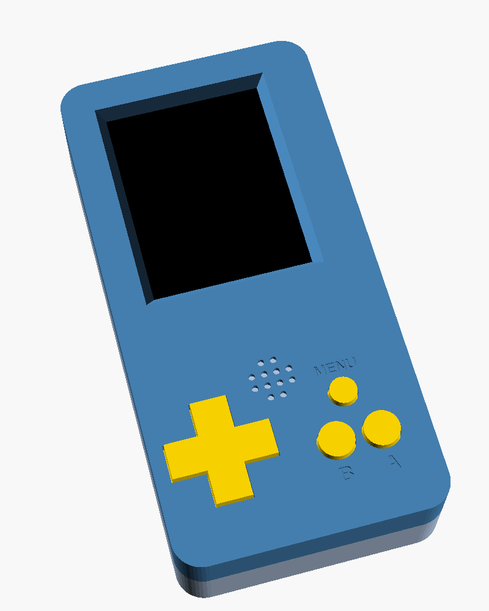

# Videoconsola ESP32

Unha videoconsola portátil feita por nós, e un SDK para aprender a programar
os teus propios xogos nela.



## Que leva

- **XIAO ESP32-C3** (o cerebro)
- Pantalla a cor **ILI9341 de 2,4"** (240 x 320 puntos)
- Cruceta, botóns **A**, **B** e **MENU**
- Zumbador para facer sons
- Batería **LiPo** que se carga polo USB-C

## Que hai neste repositorio

| Carpeta | Contido |
|---|---|
| `lib/VideoConsola/` | O SDK: a librería para programar a consola |
| `lib/VideoConsola/examples/` | Exemplos, do máis sinxelo ao máis completo |
| `xogo/` | Aquí vai o teu programa |
| `docs/` | [Primeiros pasos](docs/primeiros-pasos.md) e [referencia do SDK](docs/referencia.md) |
| `hardware/` | [PCB (KiCad), esquema, lista de materiais e carcasa 3D](hardware/README.md) |

## Un programa en 10 liñas

```cpp
#include <VideoConsola.h>

void setup() {
  consola.iniciar();
  pantalla.texto_centrado("Ola, mundo!", 150, AMARELO);
}

void loop() {
  botons.ler();
  if (botons.acaba_de_premer(BOTON_A)) son.nota(DO, 200);
}
```

## Exemplos

| Exemplo | Que aprendes |
|---|---|
| `01_OlaMundo` | Escribir texto e números |
| `02_Formas` | Rectángulos, círculos, liñas, triángulos e cores |
| `03_Botons` | Ler os botóns |
| `04_Piano` | Notas e melodías |
| `05_Mover` | Mover algo pola pantalla |
| `06_Debuxos` | Facer personaxes con números e animalos |
| `07_Bola` | Un xogo completo con puntos e récord |
| `08_Serpe` | O xogo da serpe |

## Comezar

Le os [primeiros pasos](docs/primeiros-pasos.md). En resumo, con
[PlatformIO](https://platformio.org/):

```bash
pio run -t upload
```

Isto compila o programa da carpeta `xogo/` e gravao na consola.

---

Esta actividade está patrocinada pola Xunta de Galicia e pola Axencia Para a Modernización Tecnolóxica (AMTEGA).
