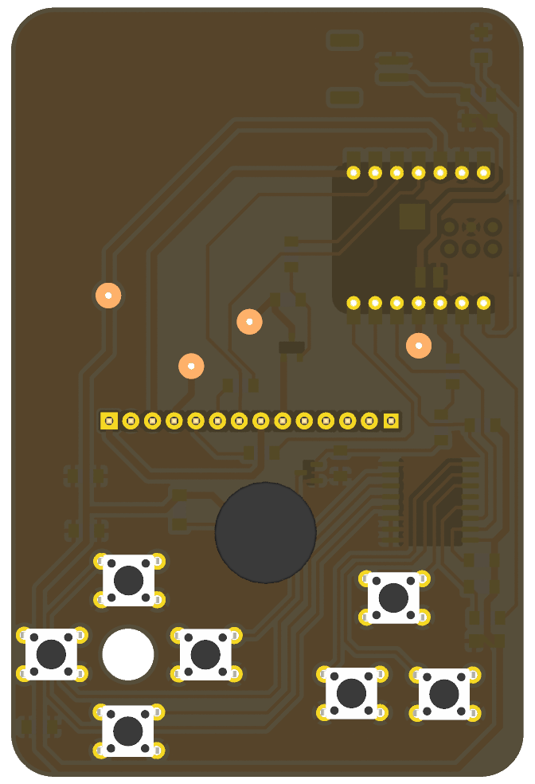
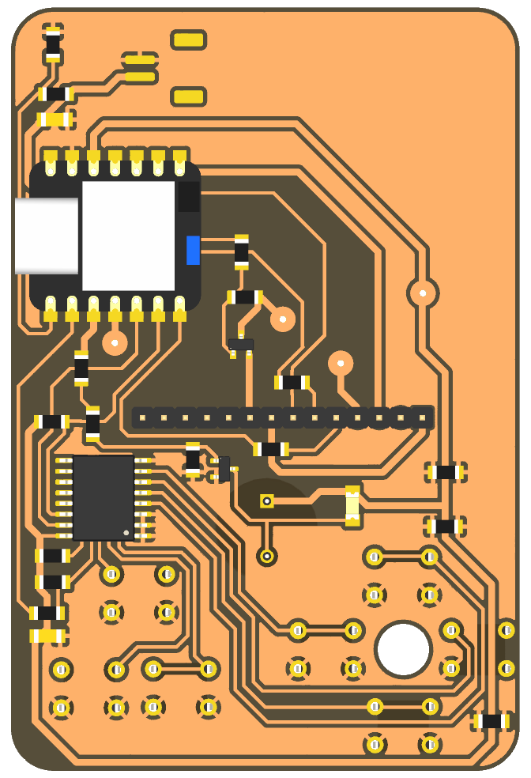
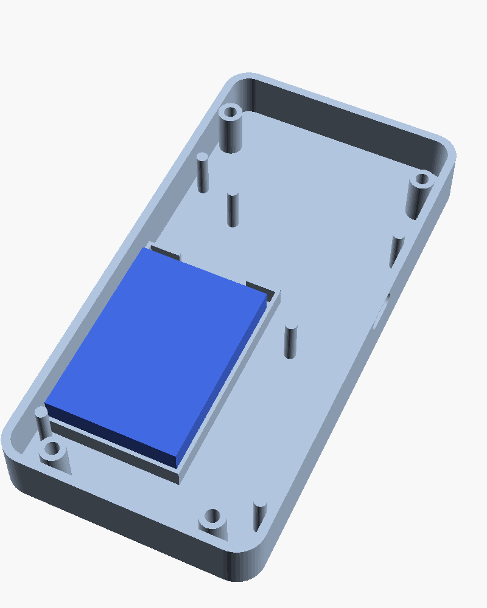

# Hardware

## Placa (PCB)

PCB dunha soa cara de 60 x 90 mm, pensada para fresar en CNC. Os botóns, o
zumbador e a pantalla van pola cara dianteira; o XIAO, o chip dos botóns e o
resto de compoñentes SMD, pola traseira (a do cobre).

| Cara dianteira | Cara traseira |
|---|---|
|  |  |

Ficheiros en `pcb/`:

- `videoconsola.kicad_pro`, `.kicad_sch`, `.kicad_pcb`: proxecto KiCad (versión 10)
- `esquema.pdf`: o esquema
- `gerber/`: Gerber e taladros, para fresar ou encargar a placa
- `lista_materiais.csv`: lista de materiais
- `videoconsola.step`: modelo 3D da placa

As resistencias de **0 ohm** fan de ponte para cruzar pistas (a placa só ten unha cara).

## Conexións

| XIAO | GPIO | Vai a |
|---|---|---|
| D0 | 2 | Batería, a través dun divisor 100k + 100k |
| D1 | 3 | INT do PCF8574A (pull-up 10k) |
| D2 | 4 | Zumbador, a través dun transistor MMBT3904 |
| D3 | 5 | Pantalla RESET |
| D4 | 6 | I2C SDA (pull-up 4k7) |
| D5 | 7 | I2C SCL (pull-up 4k7) |
| D6 | 21 | Pantalla D/C |
| D7 | 20 | Pantalla CS |
| D8 | 8 | Pantalla SCK |
| D9 | 9 | Acende a pantalla (MOSFET, nivel alto = acesa) |
| D10 | 10 | Pantalla MOSI |
| BAT+ / BAT- | | Batería LiPo (conector JST-PH) |

Botóns no PCF8574A (enderezo I2C `0x38`): P0 arriba, P1 abaixo, P2 esquerda,
P3 dereita, P4 B, P5 A, P6 MENU. Cada botón vai a GND.

## Lista de materiais

| Cant. | Compoñente | Referencias |
|---|---|---|
| 1 | Seeed Studio XIAO ESP32-C3 | M1 |
| 1 | Pantalla TFT 2,4" ILI9341 SPI, 240 x 320, módulo de 14 pins (MSP2402) | J2 |
| 1 | PCF8574A, SOIC-16 | U1 |
| 7 | Pulsador 6 x 6 x 5 mm, de patas | SW1-SW6, SW_MENU1 |
| 1 | Zumbador pasivo de 12 mm (CEM-1203) | BZ1 |
| 1 | Transistor NPN MMBT3904, SOT-23 | Q1 |
| 1 | MOSFET de canle N, SOT-23 | Q2 |
| 1 | Díodo 1N4148W | D1 |
| 2 | Condensador 100 nF, 1206 | C1, C2 |
| 2 | Resistencia 4k7, 1206 | R2, R3 |
| 3 | Resistencia 10k, 1206 | R4, R11, R16 |
| 2 | Resistencia 100k, 1206 | R8, R9 |
| 2 | Resistencia 1k, 1206 | R10, R17 |
| 7 | Resistencia 0 ohm, 1206 (pontes) | R5-R7, R12-R14, R18 |
| 1 | Conector JST-PH 2 pins, SMD horizontal | J_BAT1 |
| 1 | Batería LiPo 3,7 V 1800 mAh, 103450 (10 x 34 x 50 mm) con conector JST-PH | |
| 4 | Parafuso M3 x 25 de cabeza avellanada | |

## Carcasa

Carcasa en dúas metades, deseñada en OpenSCAD a partir das medidas da PCB.

| Fronte | Traseira (co oco da batería) |
|---|---|
|  |  |

Ficheiros en `carcasa/`:

- `fronte.stl`: a metade dianteira (ventá da pantalla, botóns e reixa do zumbador)
- `traseira.stl`: a tapa de atrás (oco para a batería e saída do USB-C)
- `botons.stl`: cruceta, A, B e MENU
- `carcasa.scad`: o deseño, con todas as medidas como parámetros

### Imprimir

- PLA ou PETG, capa de 0,2 mm.
- `fronte.stl` coa cara de fóra apoiada na cama.
- `traseira.stl` co fondo apoiado na cama.
- `botons.stl` tal como está (a cara de arriba dos botóns apoiada na cama).

### Montar

1. Solda a pantalla directamente na PCB, co separador de plástico dos pins.
2. Pon os botóns no seu sitio na fronte e encaixa a PCB enriba
   (a cruceta ten un pivote que entra no furado de 6 mm da placa).
3. Conecta a batería e déitaa no seu oco da traseira.
4. Pecha cos 4 parafusos M3 x 25 desde atrás.

### Axustar

Se a túa pantalla, batería ou botóns son diferentes, cambia as medidas ao
principio de `carcasa.scad` e volve exportar os STL:

```bash
openscad -D 'parte="fronte"'   -o fronte.stl   carcasa.scad
openscad -D 'parte="traseira"' -o traseira.stl carcasa.scad
openscad -D 'parte="botons"'   -o botons.stl   carcasa.scad
```

Con `parte="montaxe"` vese todo montado xunto coa electrónica, para revisar.
